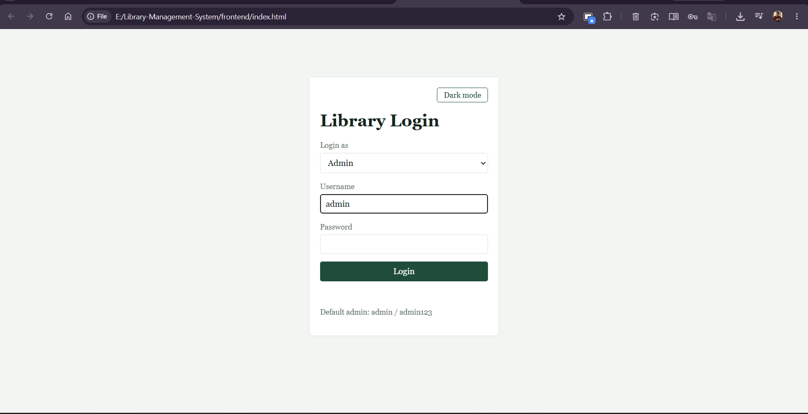
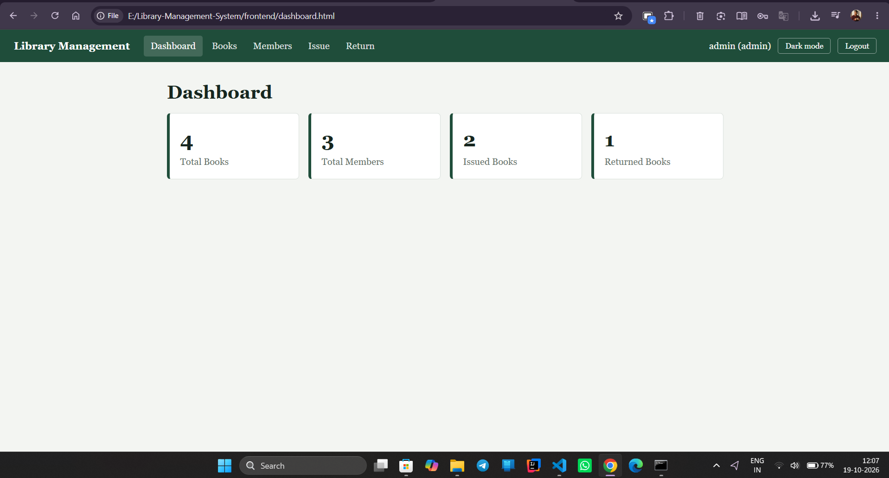
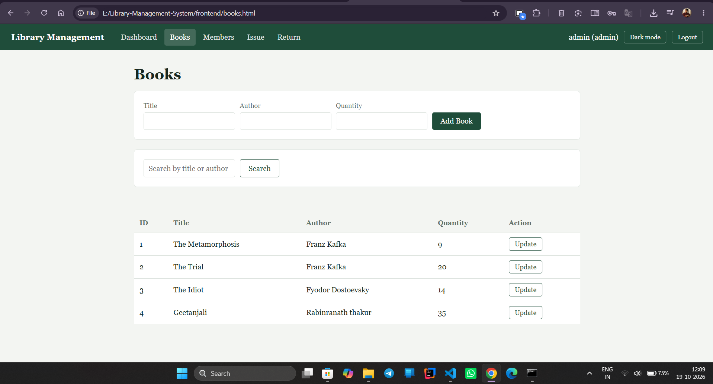
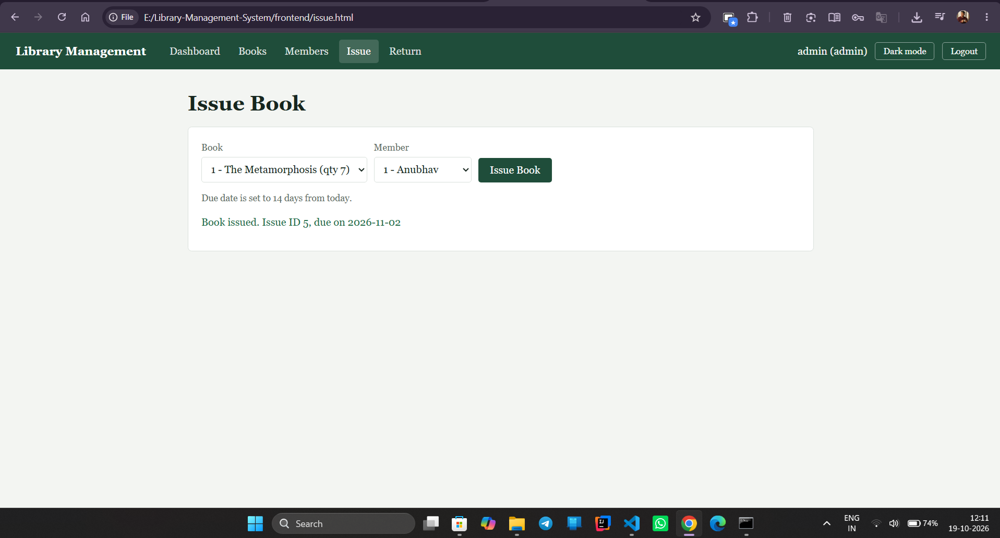

# Library Management System (Java + MySQL + HTML/CSS/JS)

## Project Overview
A GitHub-ready academic project demonstrating Java OOP, JDBC, MySQL database handling, and a frontend UI.
The Java backend (JDBC + DAO pattern) talks to MySQL, and the HTML/CSS/JS frontend connects to it.

## Features
- Admin login and Member login
- Dashboard: Total Books, Total Members, Issued Books, Returned Books
- Books: Add, Update, Search, View
- Members: Add, Update, Search, View
- Issue book (availability check, saves record, reduces quantity)
- Return book (updates return date, increases quantity)
- Due date calculation (14 days) and late return checking

## Tech Stack
- Backend: Core Java (JDK 21), JDBC, OOP, Exception Handling, Collections Framework
- Database: MySQL (`library_management`)
- Frontend: HTML5, CSS3, JavaScript
- Tools: VS Code, Git + GitHub

## Database Schema
Database: `library_management`

| Table | Columns |
|---|---|
| admin | id, username, password |
| members | id, name, email, phone |
| books | id, title, author, quantity |
| issue_records | id, book_id, member_id, issue_date, due_date, return_date |

Full script: [`database/library.sql`](Library-Management-System/database/library.sql)

## Screenshots

### Login


### Dashboard


### Books


### Issue Book


## How to Run
1. Install JDK 21, MySQL Server and the MySQL JDBC Connector (`mysql-connector-j` jar).
2. Run `database/library.sql` in MySQL.
3. Open `backend/src/database/DBConnection.java` and set your MySQL password.
4. Put the connector jar in `backend/lib/` and, from the `backend` folder, compile and run:

   Windows:
   ```
   mkdir out
   javac -cp "lib/*" -d out src\Main.java src\model\*.java src\dao\*.java src\database\*.java src\exception\*.java
   java -cp "out;lib/*" Main
   ```
   Linux / macOS:
   ```
   mkdir -p out
   javac -cp "lib/*" -d out $(find src -name "*.java")
   java -cp "out:lib/*" Main
   ```
5. Open `frontend/index.html` in the browser.
   - Admin login: `admin` / `admin123`
   - Member login: member's email + phone (add a member from the Members page first)
